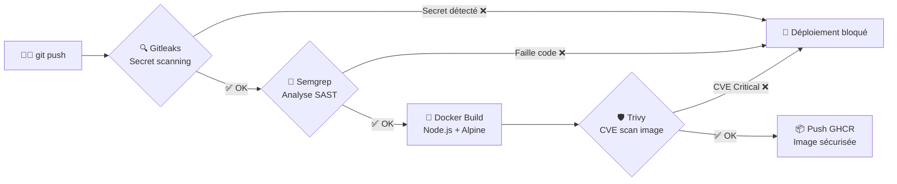

# Pipeline DevSecOps — Shift-Left Security (Node.js + Docker + GitHub Actions)

Pipeline CI/CD qui bloque automatiquement tout déploiement vulnérable.
Approche Shift-Left : les failles sont détectées avant d'atteindre la production.

---

## Architecture du pipeline

---

## Stack

| Composant | Technologie |
|---|---|
| Application | Node.js — application web |
| Conteneur | Docker (Alpine Linux) |
| CI/CD | GitHub Actions |
| Secret scanning | Gitleaks |
| Analyse statique (SAST) | Semgrep |
| Scan CVE image | Trivy (CRITICAL/HIGH) |
| Registre d'images | GitHub Container Registry (GHCR) |

---

## Les 4 étapes de blocage — preuves de concept

### Étape 1 — Blocage par Gitleaks

Un faux secret AWS a été introduit intentionnellement dans le code source.
Gitleaks a détecté la fuite et bloqué le pipeline avant tout push vers le registre.

### Étape 2 — Blocage par Semgrep

Secret retiré. Semgrep a ensuite détecté l'absence de middleware CSRF
dans l'application Node.js et bloqué la compilation.
**Fix appliqué :** ajout des middlewares de protection CSRF requis.

### Étape 3 — Blocage par Trivy

Image buildée. Trivy a identifié des CVE critiques sur Alpine Linux
(version obsolète) et sur npm.
**Fix appliqué :** migration vers Node.js 22 + mise à jour npm.

### Étape 4 — Déploiement réussi ✅

Après remédiation complète, les 4 étapes sont passées au vert.
L'image Docker sécurisée a été publiée automatiquement sur GHCR.

---

## Résultats

- 3 failles bloquées avant production (secret, CSRF, CVE Alpine)
- 0 vulnérabilité CRITICAL/HIGH sur l'image finale
- Déploiement automatisé vers GHCR après remédiation complète
- Durée totale de la pipeline : < 3 minutes

---

## Limites

- Pipeline sans étape de tests fonctionnels (Pytest / Jest)
- Pas de déploiement vers un environnement de préprod
- Semgrep en mode open-source — couverture partielle des règles
- Image Alpine : surface d'attaque réduite mais surveillance CVE continue nécessaire
